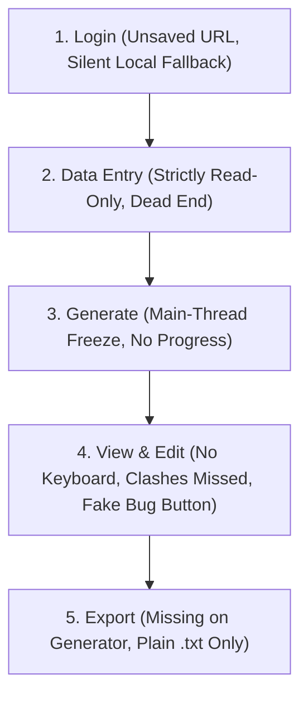

# BU Pulse Frontend Engineering & UX Audit Report

**Date:** November 4, 2026  
**Auditor:** Senior Next.js Engineer & UX Auditor  
**Project:** BU Pulse Timetabling System (Next.js 15 / React 19 / Tailwind CSS v4)  
**Scope:** Frontend Codebase Audit (`app/`, `components/`, `views/`, `lib/`)

---

## 1. Project Context & Architectural Overview

BU Pulse is an institutional timetable generation, governance, and review system designed for Babcock University. It supports multiple governance roles across academic departments:
- **Departmental Technical Officer (Dept T.O):** Manages course allocations, configures faculty scheduling constraints, runs combinatorial timetable generation, edits drafts via an interactive schedule grid, and submits drafts for approval.
- **Head of Department (HOD):** Reviews departmental timetable drafts, inspects conflicts, approves drafts to forward to Dean, or returns drafts with feedback.
- **School Dean:** Reviews multi-department school submissions, verifies inter-departmental harmony, and signs off to Academic Planning.
- **Academic Planning Technical Officer / Super Admin:** Monitors university-wide schedule clashes, configures institutional time locks and constraint archetypes, and publishes master timetables campus-wide.

### Repository File Structure by Page & Feature

- **Routing & Framework Infrastructure:**
  - `app/layout.tsx`: Root HTML layout with Inter font and `AppProvider` wrapper.
  - `app/page.tsx`: Root entrypoint rendering `<App />`.
  - `app/globals.css`: Global CSS entrypoint, Tailwind CSS v4 imports, design token variables.
  - `next.config.ts`: Next.js standalone output configuration.
  - `App.tsx`: Central SPA router, view switching, role-based navigation guards, and top-level layout wrapper.
- **App Router Subroute Proxies:**
  - `app/dashboard/page.tsx`: Overview dashboard route.
  - `app/allocations/page.tsx`: Course allocations route.
  - `app/venues/page.tsx`: Venues & room schedules route.
  - `app/constraints/page.tsx`: Lecturer constraints route.
  - `app/generate/page.tsx`: Timetable generation & grid editing route.
  - `app/history/page.tsx`: Submission timeline & status history route.
  - `app/hod-review/page.tsx`: HOD review & sign-off route.
  - `app/dean-review/page.tsx`: Dean school-level review route.
  - `app/academic-planning/page.tsx`: Academic Planning review queue route.
  - `app/academic-planning/published/page.tsx`: Master published schedules route.
  - `app/academic-planning/clashes/page.tsx`: Cross-departmental venue clash detection route.
  - `app/academic-planning/analytics/page.tsx`: Institutional analytics & heatmap route.
  - `app/academic-planning/constraints/page.tsx`: Master venue imports & time-lock management route.
  - `app/academic-planning/audit/page.tsx`: Institutional audit log trail route.
- **API Routes:**
  - `lib/api.ts`: Centralized fetch client, error classes, and service modules.
- **Shared Components & UI Primitives:**
  - `components/Sidebar.tsx`: Multi-role responsive navigation sidebar.
  - `components/TopBar.tsx`: Header bar with notifications, account switcher, and search.
  - `components/LoginScreen.tsx`: Authentication screen (API login and test profile switcher).
  - `components/ui.tsx`: Core UI primitives (`Card`, `Pill`, `Button`, `Skeleton`, `ConfirmationModal`, etc.).
  - `components/TimetableModal.tsx`: Read-only timetable grid modal with export helper.
  - `components/ReviewRequirements.tsx`: Live constraint and departmental event summary component.
- **Departmental Workspace Views (Dept T.O):**
  - `views/Dashboard.tsx`: Overview KPI cards, approval pipeline, and quick actions.
  - `views/Allocations.tsx`: Searchable and filterable course allocations list.
  - `views/Venues.tsx`: Departmental venue directory and weekly availability matrix.
  - `views/Constraints.tsx`: Faculty leave, day off, and dynamic rule builder.
  - `views/Generate.tsx`: Constraint validation, automated engine solver, and drag-and-drop timetable grid.
  - `views/History.tsx`: Audit trail timeline and rejection feedback banner.
- **Governance & Sign-Off Views:**
  - `views/HODReview.tsx`: HOD verification, approval, and rejection workflow.
  - `views/DeanReview.tsx`: Dean school-wide review, multi-department switcher, and approval.
- **Institutional Planning Views (Academic Planning):**
  - `views/AcademicPlanning.tsx`: Multi-department submission queue, bulk review, and sign-offs.
  - `views/AcademicPlanningPublished.tsx`: Master publication directory and campus release.
  - `views/AcademicPlanningClashes.tsx`: Venue double-booking clash matrix.
  - `views/AcademicPlanningAnalytics.tsx`: Capacity utilization and timeslot demand heatmaps.
  - `views/AcademicPlanningConstraints.tsx`: CSV venue batch importer, institutional time locks, and constraint archetypes.
  - `views/AcademicPlanningAudit.tsx`: Full institutional governance audit log.
- **Domain Engine, State & Data Seeds:**
  - `lib/AppContext.tsx`: Comprehensive application context, state sync, and optimistic mutations.
  - `lib/engine.ts`: Heuristic constraint engine, session decomposition, and collision detection.
  - `lib/data.ts`: TypeScript data schemas, seed datasets, and institutional mappings.
  - `lib/tokens.ts`: Color palette and badge tone design tokens.

---

## 2. Category A: Next.js Implementation

| # | File + line/component | Code snippet | Issue | Impact on user | Severity | Suggested fix |
|---|-----------------------|--------------|-------|----------------|----------|---------------|
| A1 | `app/*/page.tsx` (all 13 subpages) | `"use client";\nimport App from "@/App";\nexport default function DashboardPage() {\n  return <App />;\n}"` | Monolithic subroute anti-pattern: every single page route in Next.js App Router renders `<App />` instead of dedicated page components. Destroys App Router code-splitting, layout hierarchies, and metadata per route. | Massive initial JavaScript bundle loaded on every page; browser downloads the entire app before rendering any screen. | Critical | Render specific views directly inside their respective route `page.tsx` files (`<Dashboard />`, `<Generate />`, etc.) and share state via providers rather than mounting a full SPA router in every route. |
| A2 | `app/` (entire routing tree) | *(Missing files across `app/`)* | Completely missing Next.js convention files: no `loading.tsx`, `error.tsx`, `global-error.tsx`, or `not-found.tsx`. | Any uncaught runtime exception crashes the entire page into a blank white screen; route navigation exhibits no Suspense fallback. | High | Add root and segment-level `error.tsx` boundaries to catch failures gracefully, plus `loading.tsx` skeletons for async transitions. |
| A3 | `lib/AppContext.tsx` L285-L297 & L599-L614 | `const [constraintTypes, setConstraintTypes] = useState(() => {\n  if (typeof window !== "undefined") {\n    const stored = localStorage.getItem("bupulse_constraint_types");\n    if (stored) return JSON.parse(stored);\n  }\n  return defaultConstraintTypes;\n});` | Server-Client Hydration Mismatch: `AppProvider` in root layout reads `localStorage` synchronously during `useState` initialization. On server `window` is undefined; on client it is defined and returns stored state. | Causes React hydration errors (mismatched markup), layout flashes, and forced re-renders upon page load. | High | Initialize with default institutional data and synchronize `localStorage` exclusively inside a `useEffect` hook after initial client mount. |
| A4 | `components/TimetableModal.tsx` L45-L46 & L186 | `return createPortal(\n  
...
,\n  document.body\n);` | `createPortal(..., document.body)` is invoked directly without verifying client mounting state. During SSR or early hydration before `document` is available, this crashes. | Causes `ReferenceError: document is not defined` during SSR or pre-rendering. | High | Gate portal mounting behind a `mounted` boolean state initialized to `false` and set to `true` in `useEffect`. |
| A5 | `lib/api.ts` L26-L38 | `export function getStoredToken(): string | null {\n  if (typeof window === "undefined") return null;\n  return localStorage.getItem("bupulse_token");\n}` | Insecure credential storage: JWT bearer authentication tokens are stored in unencrypted `localStorage`, accessible by any client-side script or third-party dependency. | Leaves session tokens vulnerable to token theft via Cross-Site Scripting (XSS). | High | Migrate token storage to secure, `HttpOnly`, `SameSite=Lax` cookies handled via Next.js Middleware or server endpoints. |
| A6 | `App.tsx` L185-L187 | `if (!currentUser) {\n  return <LoginScreen onLogin={handleLogin} />;\n}` | Missing route protection & redirect tracking: unauthenticated visitors loading `/generate` or `/academic-planning` receive `<LoginScreen />` inline while the browser URL stays at `/academic-planning`. | User is confused about what page they are on; deep linking fails because redirect paths are not captured. | Medium | Implement Next.js `middleware.ts` to redirect unauthenticated users to `/login?redirect=...`. |
| A7 | Resolved | Removed the orphaned `app/api/upload-allocations` route that spawned `python3` from a Vercel Function. | Eliminates an unsupported runtime dependency and an unauthenticated file-processing attack surface. | N/A | Resolved |

---

## 3. Category B: API Handling in the Frontend

| # | File + line/component | Code snippet | Issue | Impact on user | Severity | Suggested fix |
|---|-----------------------|--------------|-------|----------------|----------|---------------|
| B1 | `lib/AppContext.tsx` L1192-L1206 | `try {\n  await timetableApi.saveDraft({ ... });\n  return true;\n} catch (err) {\n  return true; // Local store updated successfully\n}` | Silent API failure suppression: `saveTimetableDraft` catches network/backend errors and returns `true`, tricking the caller into believing backend persistence succeeded. | User is told "Draft saved successfully", but refreshing the page or logging in from another device loses all work because the backend failed. | Critical | Return `{ success: false, error: err.message }` and display a clear persistence error notification allowing manual retry. |
| B2 | `lib/AppContext.tsx` L1391-L1401 | `try {\n  await timetableApi.updateStatus(...);\n  return true;\n} catch (err) {\n  return true;\n}` | Silent governance status failure: `updateTimetableStatus` catches API rejections and returns `true`, advancing workflow state locally while the backend remains unchanged. | Department T.O believes submission was sent to HOD, but HOD never receives it on their dashboard. | Critical | Propagate error to caller, revert local optimistic state, and show a blocking submission failure modal. |
| B3 | `views/AcademicPlanning.tsx` L525-L534 & `views/AcademicPlanningPublished.tsx` L134-L138 | `try {\n  await workflowApi.publish(s.department);\n} catch (err) {\n  console.warn(\`Publish all failed for \${s.department}:\`, err);\n}\nonAuditEntry({ action: "published", ... });` | Failure-blind bulk publishing: When bulk publishing fails for a department, the error is swallowed and logged to console, but the audit entry is created and the UI marks it "published". | Academic Planning believes a master schedule is published campus-wide when the server call actually failed. | Critical | Collect failed department IDs, notify the user which departments failed to publish, and only update state for successful ones. |
| B4 | `lib/AppContext.tsx` L952-L1095 | `const loadDepartmentData = useCallback(async (deptName: string, schoolName?: string) => {\n  ... 10 un-cancellable parallel fetch calls ...\n});` | Race condition on department switching: `loadDepartmentData` fires 10 independent requests with no `AbortController`. If a user switches departments quickly, earlier slower requests overwrite newer data. | Dashboard displays data belonging to the wrong department; data corruption during saves. | High | Bind an `AbortController` signal to the active request cycle and abort in-flight requests when switching departments. |
| B5 | `lib/api.ts` L60-L73 | `response = await fetch(url, { ...options, headers });` | Missing request timeouts: `apiRequest` has no timeout configuration (`AbortSignal.timeout(...)`). Render free-tier cold starts or dropped connections hang indefinitely. | UI freezes in loading state indefinitely with no error or retry button when backend cold-starts or lags. | High | Add default request timeout (e.g. 15-20s) with user-friendly retry button on timeout. |
| B6 | `views/HODReview.tsx` L118, L140, `views/DeanReview.tsx` L205, `views/AcademicPlanning.tsx` L555 | `alert(err?.message || "Failed approving submission as HOD.");` | Blocking native `window.alert()` dialogs used for API error reporting across all governance sign-off views. | Freezes main thread, breaks mobile browsers, fails silently in iframe sandbox previews, and degrades UX. | Medium | Replace native browser `alert()` with non-blocking toast notifications or embedded alert banners. |
| B7 | `views/Dashboard.tsx` L75-L84, `views/History.tsx` L24-L37 | `useEffect(() => {\n  workflowApi.getTimeline(deptName).then(...);\n}, [deptName]);` | Duplicate uncoordinated fetching: Child views fetch timeline and venues independently on mount even though `AppContext` just fetched them during `loadDepartmentData`. | Triggers redundant server requests, rate limiting, and momentary layout flickers. | Low | Consume cached timeline from `AppContext` and only provide a manual "Refresh" button for refetching. |

---

## 4. Category C: Timetable-Specific Logic and UX

| # | File + line/component | Code snippet | Issue | Impact on user | Severity | Suggested fix |
|---|-----------------------|--------------|-------|----------------|----------|---------------|
| C1 | `views/Generate.tsx` (entire component) | *(No export button anywhere in 4,252 lines)* | Complete absence of Export in generator view: The Departmental T.O who configures, solves, and edits the timetable has NO export button to download or print the schedule. | Dept T.O cannot download their schedule for internal faculty meetings, printing, or offline review. | Critical | Add an "Export Timetable" dropdown supporting formatted PDF, Excel (.xlsx), and standard CSV formats. |
| C2 | `views/AcademicPlanningClashes.tsx` L33-L66 | `const key = \`\${sess.venue}::\${sess.day}::\${sess.slot}\`;\n... if (depts.size > 1) clashes.push(...)` | Flawed clash detection logic: (1) Does not account for multi-hour sessions (`duration: 2` occupying consecutive slots). (2) Ignores internal departmental room double-bookings (`depts.size > 1`). | Venue double-bookings spanning 2-hour sessions go completely undetected, causing physical classroom collisions on campus. | Critical | Compute time ranges using start/end indices rather than slot string keys, and detect clashes regardless of whether they occur intra-department or cross-department. |
| C3 | `views/Generate.tsx` L508-L531 | `import("../lib/engine").then(({ generateTimetable }) => {\n  const result = generateTimetable(...);\n  ... saveTimetableDraft ...\n});` | Synchronous main-thread engine execution: generation runs synchronously on the main JavaScript thread without progress stages, step feedback, or cancel capability. | Browser tab freezes and becomes completely unresponsive ("Page Unresponsive" warning) during 170+ course generation. | High | Offload `generateTimetable` to a Web Worker or yield with `requestAnimationFrame`/`async` batching, displaying step-by-step progress (e.g. "Assigning Core courses...", "Verifying Chapel locks..."). |
| C4 | `views/Generate.tsx` L271-L3200 | `
` | Zero keyboard accessibility for grid editing: Manual moves, swaps, and cell assignments work exclusively via HTML5 mouse drag-and-drop. | Keyboard-only users and screen-reader users are completely unable to edit the timetable. | High | Implement keyboard-driven cell selection (Space/Enter to pick up, Arrow keys to navigate target slot, Enter to drop/swap). |
| C5 | `components/TimetableModal.tsx` L15-L30 | `const blob = new Blob(["Day\\tTime\\tCode\\tLecturer\\tVenue\\tNote\\n" + rows.join("\\n")], { type: "text/plain" });\na.download = \`BUPulse-\${sub.department}.txt\`;` | Non-standard text export: exports tab-delimited plain text `.txt` file instead of standard spreadsheet or document formats. | Users cannot open or present the timetable in standard tools (Excel, Word, Google Sheets) without delimiter import configuration. | High | Export standard `.xlsx` (via SheetJS/ExcelJS) or formatted `.csv`, plus printable PDF layout. |
| C6 | `views/Allocations.tsx` L286-L291 | `<Lock size={13} /> Locked · Strictly Read-Only` | Data entry flow dead end: System description specifies users enter courses and allocations, but the Allocations view is 100% read-only with no UI to add, edit, or upload courses. | Department T.O cannot input new courses or fix lecturer assignment mistakes. | High | Provide "Add Allocation" modal and "Import Allocations (Excel/CSV)" button in the UI. |
| C7 | `components/TopBar.tsx` L313-L318 | `<button onClick={() => handleFixFlagged("BU-GST 205")}>\n  Fix BU-GST 205 →\n</button>` | Hardcoded revision target: Notification bell button hardcodes `"BU-GST 205"` as the course to fix, regardless of which course was actually rejected. | Dept T.O clicks "Fix" on a rejection notice and is navigated to the wrong course. | Medium | Extract the rejected course code dynamically from `rejection.comment` or timeline metadata. |
| C8 | `views/Generate.tsx` (general edit flow) | *(No `beforeunload` or route leave guard)* | Missing unsaved changes guard: if user makes manual drag-and-drop adjustments and accidentally refreshes or navigates away before debounced save completes, changes are lost silently. | Loss of complex manual schedule arrangements with no warning dialog. | Medium | Add `window.addEventListener("beforeunload", ...)` and Next.js navigation interception when there are pending edits. |

---

## 5. Category D: General Component Problems

| # | File + line/component | Code snippet | Issue | Impact on user | Severity | Suggested fix |
|---|-----------------------|--------------|-------|----------------|----------|---------------|
| D1 | `views/Generate.tsx` & `views/AcademicPlanningConstraints.tsx` | `// Generate.tsx: 4,252 lines\n// AcademicPlanningConstraints.tsx: 4,462 lines` | Giant monolithic God components: Single files containing 4,000+ lines mixing drag-and-drop engines, modal states, CSV parsers, grid math, and SVG renderers. | Causes sluggish UI performance, extreme re-render cascading, and impossible maintainability. | High | Break down into isolated components: `<TimetableGrid />`, `<ConflictDrawer />`, `<VenueImportModal />`, `<TimeLockEditor />`. |
| D2 | `views/Dashboard.tsx` L389 | `["Largest cohort", \`\${Math.max(...allocations.map((a) => a.size))} students\`]` | Unchecked Math.max on empty array: If allocations list is empty (while loading or for new departments), `Math.max()` evaluates to `-Infinity`. | Dashboard displays "-Infinity students" to the user. | Medium | Provide a safe fallback: `allocations.length > 0 ? Math.max(...) : 0`. |
| D3 | `views/AcademicPlanningAnalytics.tsx` L101, L107 | `style={{ width: \`\${(pipeline.published / pipeline.total) * 100}%\` }}` | Division by zero: When `pipeline.total === 0`, `0 / 0` evaluates to `NaN`. | Inline style becomes `width: NaN%`, triggering React console warnings and broken progress bars. | Medium | Guard with `pipeline.total > 0 ? (pipeline.published / pipeline.total) * 100 : 0`. |
| D4 | `views/Venues.tsx` L44-L48 | `useEffect(() => {\n  if (!localVenues || localVenues.length === 0) {\n    loadVenues();\n  }\n}, []);` | Stale closure & missing hook dependencies: `useEffect` has empty dependency array `[]` but reads `localVenues` and `loadVenues`. | Venues screen fails to reload when switching user role or department. | Medium | Include `loadVenues` and dependencies in array or move fetching logic into a standard query hook. |
| D5 | `views/AcademicPlanningConstraints.tsx` L2408-L2411 | `const showToast = (msg: string) => {\n  setToastMessage(msg);\n  setTimeout(() => setToastMessage(null), 3000);\n};` | Uncleaned timer memory leak: `setTimeout` is triggered without storing the timer handle in a ref or cleaning it up on unmount. | Setting state on unmounted component if user switches tabs within 3 seconds. | Low | Store timeout in a `useRef` and clear it on component unmount. |
| D6 | `lib/data.ts` L43 & `lib/api.ts` L40 | `apiRequest<T = any>(...)\nconst u = res.user as any;` | Loose typing and over-reliance on `any` throughout API client, auth methods, and component props. | TypeScript compiler fails to catch missing or renamed properties (e.g. `role_label` vs `roleLabel`). | Low | Define strict TypeScript interfaces for all API payloads and remove `any` casts. |

---

## 6. Category E: General UX and Accessibility

| # | File + line/component | Code snippet | Issue | Impact on user | Severity | Suggested fix |
|---|-----------------------|--------------|-------|----------------|----------|---------------|
| E1 | `components/TopBar.tsx` L94-L98 | `<input\n  placeholder="Search courses, venues…"\n  className="w-52 rounded-xl border border-line bg-card py-2 pl-9 pr-3 text-[13px] text-ink placeholder:text-muted outline-none transition focus:border-brand focus:ring-2 focus:ring-brand-soft"\n/>` | Fake placebo search input: The search input in the global top header has no `value`, no `onChange`, and no form submission handler. | User types into search bar expecting results and absolutely nothing happens. | High | Connect to global search modal/palette or remove the decorative search bar. |
| E2 | `components/LoginScreen.tsx` L187-L204 & L207-L224 | `<label className="...">Institutional Email</label>\n<input type="text" ... />` | Missing form label associations and wrong input type: Labels lack `htmlFor`, inputs lack `id`. Email field uses `type="text"` instead of `type="email"`. | Screen readers cannot announce field labels; mobile keyboards do not show email layout (`@` key); clicking label does not focus input. | High | Add matching `id` and `htmlFor` attributes; change to `type="email"` with `autoComplete="email"`. |
| E3 | `components/TimetableModal.tsx`, `views/Allocations.tsx` L47-L152 (`DetailModal`), `views/Constraints.tsx` L284-L432 (`AddModal`) | `
` | Inaccessible modal dialogs: Modals lack `role="dialog"`, `aria-modal="true"`, and `aria-labelledby`. They do not trap keyboard focus or close on `Escape` key. | Screen-reader and keyboard users cannot perceive or dismiss modals cleanly. | High | Implement accessible modal semantics, `Escape` key listener, and focus trapping. |
| E4 | `views/Allocations.tsx` L371-L442 | `
...
` | Non-semantic table markup: Data table is constructed entirely out of generic `div` and `button` tags rather than semantic `<table>`, `<thead>`, `<th>`, `<tbody>`, `<tr>`, `<td>`. | Screen readers cannot announce column headers or row indices; broken table navigation for assistive tech. | Medium | Use semantic HTML `<table>` elements with proper `scope="col"` headers. |
| E5 | `views/Allocations.tsx` L399 & `views/Generate.tsx` L2900 | `grid-cols-[110px_1fr_160px_80px_70px_76px_74px]` | Broken mobile layout: Tables and grids force multi-column desktop grids without responsive card collapsing on viewports under 640px. | Text collides and overflows on mobile screens, making courses unreadable. | Medium | Add horizontal scrolling container or collapsible card layout for mobile viewports. |
| E6 | `components/TopBar.tsx` L131-L133 | `
` | Viewport overflow on small screens: Role/Account switcher popover is fixed at `w-80` (320px) pinned to the right edge. On mobile viewports (<360px), it bleeds off-screen. | Dropdown is partially clipped off-screen on mobile devices; cannot tap accounts. | Low | Constrain popover width: `w-[calc(100vw-2rem)] max-w-sm sm:w-80`. |

---

## 7. Issue Count Summary by Severity

| Severity | Count | Primary Areas of Concern |
|----------|-------|--------------------------|
| **Critical** | **6** | Silent save/publish failures, SPA proxy routing anti-pattern, missing generator export, flawed clash detection algorithm. |
| **High** | **12** | Missing error/loading boundaries, hydration mismatches, insecure token storage, request race conditions, main-thread freezing, inaccessible modals. |
| **Medium** | **9** | Blocking browser alerts, unassociated labels, duplicate network requests, missing `beforeunload` guards, non-semantic grid tables. |
| **Low** | **4** | Uncleaned timers, loose `any` types, popover mobile width overflow, non-coordinated mount fetches. |
| **Total** | **31** | **Comprehensive pass across all files** |

---

## 8. Top 5 Issues to Fix First

1. **Fix Silent Save and Publish API Failures (`B1`, `B2`, `B3`)**
   - *Reason:* Users are actively deceived into believing their work is safely persisted. The UI displays green "Saved" and "Published" notifications when the backend API fails or is unreachable, resulting in permanent data loss upon page refresh.
2. **Implement Export on the Timetable Schedule Screen (`C1`, `C5`)**
   - *Reason:* Generating a schedule is the primary business outcome of the system. Currently, the Departmental T.O has no export button on the generator screen, and existing exports produce raw `.txt` files rather than PDF, Excel, or CSV.
3. **Decouple `<App />` from All Next.js Subroutes (`A1`)**
   - *Reason:* Every route file renders `<App />`, breaking Next.js App Router code-splitting, layout hierarchies, and metadata, forcing every user to download the entire application bundle upfront.
4. **Fix Flawed Clash Detection in `AcademicPlanningClashes` (`C2`)**
   - *Reason:* The algorithm only compares exact slot strings, completely failing to catch overlaps caused by 2-hour sessions and ignoring same-department room collisions.
5. **Offload Timetable Generation from the Main UI Thread (`C3`)**
   - *Reason:* Synchronous combinatorial timetable generation blocks the main JavaScript thread, locking the browser tab and triggering "Page Unresponsive" warnings on large course allocations.

---

## 9. User Flow Breakdown & Disconnects

1. **Login Flow:**
   - Unauthenticated visitors hitting `/generate` or `/academic-planning` receive `<LoginScreen />` inline without updating the URL or preserving return redirect paths.
   - Quick Login catches backend errors silently and logs in with an empty token, causing subsequent backend saves to fail with 401 Unauthorized errors without explanation.
2. **Data Entry Flow:**
   - The user flow requires users to enter courses and allocations, but the Allocations screen is strictly read-only (`Locked · Strictly Read-Only`).
   - Allocation upload remains outside the frontend workflow; the previously orphaned server endpoint was removed during Vercel preparation.
3. **Generation Flow:**
   - The generator lacks progress indicators and cancel buttons.
   - It freezes the browser tab during generation and silently catches save errors, falsely reporting success.
4. **View & Edit Flow:**
   - Manual timetable editing is mouse-only (no keyboard support).
   - Moving multi-hour sessions can clip across closing hours without warning.
   - The notification bell has a hardcoded button (`Fix BU-GST 205 →`), pointing to the wrong course regardless of what was rejected.
5. **Export Flow:**
   - The Departmental T.O has no export button on `/generate`.
   - Modals in Academic Planning only download `.txt` files with tab characters (`\t`) instead of standard Excel (`.xlsx`) or printable PDF layouts.

---

## 10. Audit Coverage & Unreviewed Files

**Unreviewed Files:** *None.*  
All 44 files across the frontend repository (`app/`, `components/`, `views/`, and `lib/`) were reviewed in detail.
