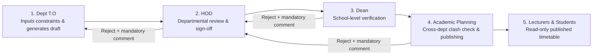
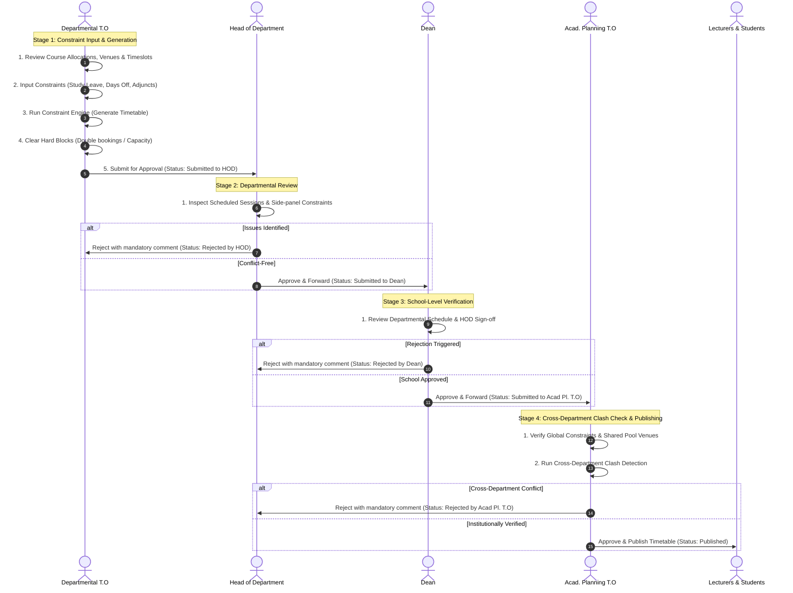

# BU Pulse — Timetabling System Flow

This document outlines the complete end-to-end architecture, role-by-role screen flows, status lifecycle, and constraint engine rules for the **BU Pulse Timetabling System**, based on the UX specifications in [`BU_Pulse_Timetabling_UX_Flow_and_User_Stories.md`](./BU_Pulse_Timetabling_UX_Flow_and_User_Stories.md).

---

## 1. High-Level Approval & Delivery Pipeline



---

## 2. Status Lifecycle Matrix

| Status | Triggered By | Meaning / Next Action |
| :--- | :--- | :--- |
| `Not started` | Default | No constraints entered yet |
| `Constraints in progress` | Dept T.O | Study leave, days off, and adjunct availability being inputted |
| `Draft generated` | Dept T.O | Timetable generated, conflict-checked, editable |
| `Submitted to HOD` | Dept T.O | Enters HOD review queue (notifications fired) |
| `Rejected by HOD` | HOD | Returned to Dept T.O with mandatory feedback comment |
| `Submitted to Dean` | HOD | Enters School Dean's review queue |
| `Rejected by Dean` | Dean | Returned to HOD for triage and re-routing |
| `Submitted to Acad Pl. T.O` | Dean | Enters Academic Planning Office review queue |
| `Rejected by Acad Pl. T.O` | Acad Pl. T.O | Returned to HOD for cross-department adjustments |
| `Published` | Acad Pl. T.O | Live institution-wide for Lecturers and Students |

---

## 3. End-to-End Sequence Flow



---

## 4. Role-by-Role Screen Breakdown

### 4.1 Departmental Timetable Officer (`deptTO`)
* **Screen 1 — Login / Authentication (`/`)**:
  * Role-based credentials & account selector.
* **Screen 2 — Dashboard (`/dashboard`)**:
  * Timetable readiness status badge (`Draft generated`, `Submitted`, etc.).
  * Approval progress bar (e.g. Step 1 of 4).
  * Pinned reviewer rejection comments with direct jump to revision.
  * Quick action navigation cards (Allocations, Venues, Constraints, Generate).
* **Screen 3 — Allocations (`/allocations`)**:
  * Lecturer-to-course allocation table (Core, Elective, GST).
  * Credit units, cohort sizes, and search/filter controls.
  * Course detail modal.
* **Screen 4 — Venues & Timeslots (`/venues`)**:
  * Assigned department venue capacity cards.
  * Interactive 5-day × 5-slot availability matrix (toggle open / blocked).
* **Screen 5 — Constraints Management (`/constraints`)**:
  * Tabs: **Study Leave**, **Days Off**, and **Adjunct Lecturers**.
  * Add constraint modal with lecturer, date range, and reason.
  * Single-click deletion and "Mark constraints complete" toggle.
* **Screen 6 — Timetable Generator & Review (`/generate`)**:
  * View modes: Calendar grid view (with time slots) and List view.
  * Real-time conflict validation banner (venue clash, capacity overage, lecturer unavailability).
  * "Jump to cell" highlighted focus.
  * One-click timetable solver (`Regenerate`).
* **Screen 7 — Submit Modal**:
  * Final constraint check gate before submission to HOD.
* **Screen 8 — Status & History (`/history`)**:
  * Complete timestamped audit trail with actor details.
  * Pinned reviewer notes and `.txt` export.

---

### 4.2 Head of Department (`hod`)
* **Screen 1 — Submissions Queue (`/hod-review`)**:
  * List of departmental drafts awaiting review or returned from higher levels.
* **Screen 2 — Timetable Review**:
  * Scheduled session cards with conflict highlights.
  * Active constraints side-panel (Study leave, days off, adjunct limits).
* **Screen 3 — Decision Actions**:
  * **Approve:** Moves status to `Submitted to Dean` and routes to Dean queue.
  * **Return to Dept T.O:** Requires mandatory feedback comment.
* **Screen 4 — Bounce-Back Triage**:
  * Handles drafts returned by the Dean or Academic Planning Office.

---

### 4.3 Dean (`dean`)
* **Screen 1 — School Submissions Dashboard (`/dean-review`)**:
  * Submissions grouped across school departments.
* **Screen 2 — Timetable Review**:
  * HOD sign-off timestamp and session overview.
* **Screen 3 — Decision Actions**:
  * **Approve:** Advances status to `Submitted to Acad Pl. T.O`.
  * **Return to HOD:** Requires mandatory rejection comment.

---

### 4.4 Academic Planning Timetable Officer (`acadPlanningTO`)
* **Screen 1 — Review Queue (`/academic-planning`)**:
  * Campus-wide submission status board.
  * Filter tabs: `All`, `Pending`, `Approved`, `Published`, `Returned`.
  * Multi-select bulk approve and bulk publish actions.
  * Full timetable inspection modal.
* **Screen 2 — Constraints Management (`/academic-planning/constraints`)**:
  * **Venue Assignments Tab:** Map venues to specific departments or assign to the shared central pool (e.g. LT 5, LT 10, Main Auditorium).
  * **Time Constraints Tab:** Institution-wide adjunct lecturer roster, global study leave, and cross-department days off.
* **Screen 3 — Venue Clash Detection (`/academic-planning/clashes`)**:
  * Algorithmic scanner detecting cross-department double bookings in shared venues.
* **Screen 4 — Published Timetables (`/academic-planning/published`)**:
  * Live timetables directory with search and `.txt`/`.ics` export.
  * Single and bulk publishing triggers.
* **Screen 5 — Analytics (`/academic-planning/analytics`)**:
  * Pipeline status breakdown.
  * Top-utilized venues ranking.
  * 5-day × 5-slot concurrent session heatmap.
  * School readiness progress.
* **Screen 6 — Audit Log (`/academic-planning/audit`)**:
  * Permanent institutional audit trail of all approvals, returns, and publish actions.

---

### 4.5 Lecturers & Students (Recipients)
* **Screen 1 — Personal / Course Timetable**:
  * Read-only weekly calendar grid and list view of published schedules.
* **Screen 2 — Notification Center**:
  * Real-time alerts when timetables are published or amended.
* **Screen 3 — Export**:
  * Downloadable `.txt`, `.ics` calendar sync, or printable view.

---

## 5. Constraint Validation Engine

```
                      ┌──────────────────────────────────────────────┐
                      │          Constraint Engine Rules             │
                      └──────────────────────┬───────────────────────┘
                                             │
               ┌─────────────────────────────┴─────────────────────────────┐
               ▼                                                           ▼
     [Hard Blocks - Block Submission]                            [Soft Warnings]
 ├── Venue double-booking                                   ├── High slot concentration
 ├── Lecturer double-booking                                ├── Back-to-back cross-campus slots
 ├── Capacity overage (Cohort size > Room capacity)         └── Single-period isolated classes
 └── Availability violation (Leave / Day off / Adjunct)
```

---

## 6. Rejection Routing Hierarchy

| Level of Rejection | Destination | Purpose |
| :--- | :--- | :--- |
| **HOD Rejection** | `Dept T.O` | Direct timetable grid revision and constraint corrections |
| **Dean Rejection** | `HOD` | Triage and resubmission, or routed down to Dept T.O |
| **Academic Planning Rejection** | `HOD` | Resolution of cross-department venue or adjunct clashes |
