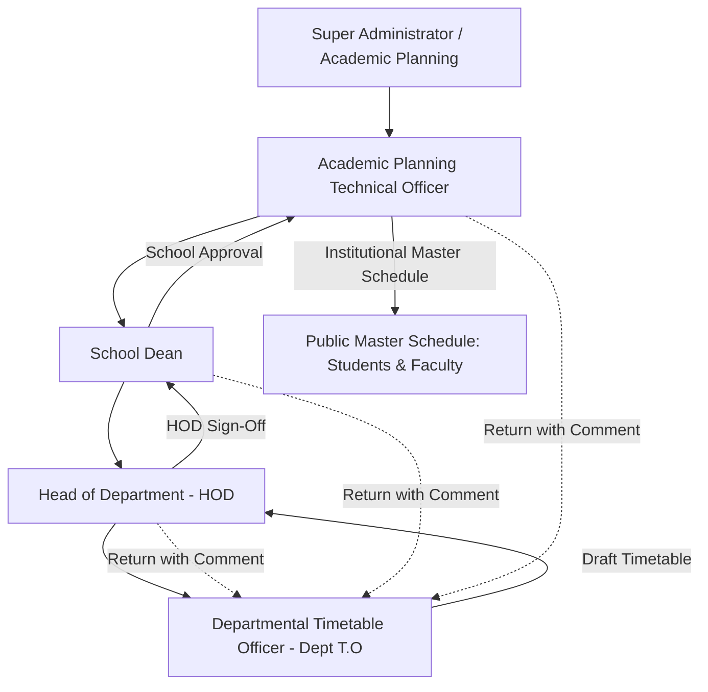

# BU Pulse Timetable System — Project Master Documentation & Development Progress

> **Document Scope**: This document provides the complete context of the **BU Pulse Timetabling System** (project background, architecture, institutional policies, and user roles) along with an exhaustive, chronological log of everything implemented to date.

---

# PART 1: PROJECT CONTEXT & ARCHITECTURE OVERVIEW

## 1. Executive Summary & Purpose
The **BU Pulse Timetabling System** is an enterprise-grade, multi-tier academic scheduling and timetable governance platform developed specifically for **Babcock University**. 

Scheduling academic lectures in a collegiate university with over 44 departments, 2,800+ course sections, and shared campus lecture complexes is an intricate combinatorial problem. Historically, manual or fragmented departmental scheduling caused:
- **Physical room double-bookings** across departments sharing faculty lecture theatres.
- **Student cohort overlaps**, where students had simultaneous lectures or staggered 1-hour clashes.
- **Lecturer double-bookings** and violation of faculty availability constraints (study leave, research days off, adjunct teaching windows).
- **Opaque approval processes**, resulting in uncontrolled revisions, untracked modifications, and conflicting published schedules.

BU Pulse resolves these issues through a **deterministic Constraint Satisfaction Problem (CSP) solver engine**, an **institutional multi-tier review and approval workflow**, and a **centralized venue and constraints registry** backed by a robust REST API.

---

## 2. Core User Personas & Governance Hierarchy

The system enforces strict role-based access control (RBAC) across five organizational tiers:

1. **Departmental Technical Officer (`deptTO`)**:
   - Represents individual academic departments (e.g., Computer Science, Accounting, Nursing).
   - Manages departmental course allocations (CCMAS/BMAS curricula).
   - Registers faculty constraints (study leave, days off, adjunct availability).
   - Generates conflict-free timetable drafts using the CSP solver engine.
   - Performs line-item manual adjustments and submits drafts to the HOD.

2. **Head of Department (`hod`)**:
   - Reviews submitted departmental timetables against curriculum requirements.
   - Evaluates teaching loads, faculty coverage, and conflict status.
   - Approves and forwards the draft to the School Dean, or returns it with feedback for revision.

3. **School Dean (`dean`)**:
   - Oversees scheduling across all constituent departments within their school (e.g., School of Computing, School of Management Sciences).
   - Identifies inter-departmental shared venue contention within the school.
   - Approves and forwards the school's timetables to Academic Planning, or returns them for revision.

4. **Academic Planning Technical Officer (`acadPlanningTO`)**:
   - University-wide administrative authority.
   - Audits campus-wide policy: operating windows and mandatory breaks configured via the backend administration panel; manages Chapel seminars and custom time locks.
   - Ingests and manages the central campus venue registry (shared pool vs. exclusive departmental rooms).
   - Defines dynamic constraint types and archetype templates.
   - Audits submissions in the institutional Review Queue, runs cross-department clash detection, and publishes the final master schedule.

5. **Super Administrator (`superAdmin`)**:
   - Full system administrative oversight, user account provisioning, and system configuration.

---

## 3. Technology Stack & Architecture

- **Frontend Application**:
  - **Framework**: Next.js 15 (App Router) + React 19 (Client Components with `"use client"`).
  - **Styling**: Tailwind CSS v4 with `@tailwindcss/postcss`.
  - **Icons**: `lucide-react`.
  - **State Management**: Centralized reactive React Context (`lib/AppContext.tsx`) with localStorage persistence and live REST API synchronization.
  - **Compiler/Bundler**: Turbopack & TypeScript 5.7 (strict type safety across all 18 application routes).
- **Backend Application (`timetable-backend`)**:
  - **Framework**: Laravel 11.
  - **Authentication**: Laravel Sanctum (Bearer Token authentication).
  - **Database**: PostgreSQL / MySQL with migrations for users, allocations, venues, timetables, sessions, constraints, time locks, and audit trails.
  - **API Standard**: RESTful JSON API under `/api/v1/*`.

---

## 4. Key Subsystems & Domain Rules

### A. Deterministic CSP Solver Engine (`lib/engine.ts`)
The scheduling engine uses a **Constraint Satisfaction Problem (CSP)** solver with **Minimum Remaining Values (MRV)** heuristics and forward checking:
- **Unit Breakdown**:
  - 3-unit courses: Automatically broken into **one 2-hour lecture block + one 1-hour session** scheduled across distinct days.
  - 2-unit courses: Scheduled as a unified **2-hour lecture block** (or optionally split into `1h + 1h`).
  - 1-unit courses: Scheduled as a single **1-hour lecture block**.
- **Standard Block Alignment**:
  - 2-hour classes are aligned strictly to standard institutional periods (`08:00–10:00`, `10:00–12:00`, `14:00–16:00`, `16:00–18:00`), preventing irregular straddles across lunch or class transitions.
- **Multi-Group & Cohort Non-Overlap**:
  - Departments with large enrollments divide cohorts into sub-groups (`Group A`, `Group B`, `Group C`, `Group D`, `Group E`, `Group F`).
  - Non-intersecting groups (e.g., `Group A` in Lab 1 and `Group B` in Lab 2) schedule concurrently in separate rooms.
  - Intersecting groups (e.g., `Group A & F` vs. `Group A & B`) are strictly prevented from colliding.
  - Unified courses (`group: "All"`, such as General Studies) reserve all groups at that level simultaneously.
- **Cross-Departmental External Booking Protection**:
  - When generating a draft, the solver queries `/timetable/external-bookings` and locks any venue already reserved by another department's submitted/approved timetable.

### B. Institutional Time Locks & Policy Windows
- **Operating Hours**: Monday through Friday, 7:00 AM – 6:00 PM (`07:00` to `17:00` slots).
- **Mandatory Daily Lunch Break**: 1:00 PM – 2:00 PM (`13:00` slot) locked university-wide across all days.
- **Wednesday Early Cutoff**: All lectures strictly conclude by 5:00 PM (`17:00` slot locked) for institutional activities.
- **Friday Early Cutoff**: All lectures strictly conclude by 1:00 PM (`13:00`+ slots locked) in observance of weekend hours.
- **Institutional Chapel Seminars (`GEDS 001`)**:
  - Pinned every weekday morning at 09:00 AM in the **University Amphitheatre** (capacity: 2,500):
    - **100 Level**: Monday 09:00 – 10:00
    - **200 Level**: Tuesday 09:00 – 10:00
    - **300 Level**: Wednesday 09:00 – 10:00
    - **400 Level**: Thursday 09:00 – 10:00
  - All cohort groups are locked during these slots; no departmental classes may run.

### C. Venue Space Management & Ownership
- **Exclusive Venues**: Allocated solely to the owning academic department.
- **Shared Pool Venues**: Accessible to other departments, subject to custodial precedence and school-level sharing rules. Shared venues preserve their custodian department owner rather than being treated as unassigned.
- **Virtual / LMS Venues**: Online and general courses (e.g. `Virtual / LMS`, capacity 5,000) do not lock physical lecture rooms, allowing multiple concurrent online courses without room collisions.

---

# PART 2: CHRONOLOGICAL RECORD OF WORK COMPLETED

The following chronological log records every feature implementation, architectural refactoring, bug fix, and API integration completed across the project lifecycle.

---

## 📅 Phase 1 — Core CSP Solver Engine & Seed Infrastructure (Oct 5 – Oct 8, 2026)

1. **CSP Solver Engine Initial Implementation (`lib/engine.ts`)**:
   - Built deterministic CSP engine using MRV (Minimum Remaining Values) heuristics.
   - Implemented course unit breakdown (3 units $\rightarrow$ 2h + 1h; 2 units $\rightarrow$ 2h).
   - Enforced operating windows (07:00 – 18:00), daily mandatory lunch break (13:00–14:00), Wednesday 17:00 cutoff, and Friday 13:00 cutoff.
   - Enforced faculty constraints (Study Leave, Days Off, Adjunct availability).
   - Added venue fitness scoring based on home department priority and seat capacity ratios.
   - Implemented cross-level global venue occupancy tracking to prevent different levels from double-booking physical rooms.

2. **Data Modeling & Seed Schemas (`lib/data.ts`)**:
   - Created TypeScript definitions: `Allocation`, `Session`, `Venue`, `Constraint`, `DeptSubmission`, `AuditEntry`, `TimelineStep`.
   - Expanded grid slots to 1-hour granularity (`07:00` to `17:00`).
   - Defined initial seed allocations spanning 100L through 400L with cohort sub-groups (`Group A`, `B`, `C`, `D`, `All`).

3. **Pre-Generation Snapshot & Two-Screen Workflow (`views/Generate.tsx`)**:
   - Designed Screen 1 (Pre-Generation Snapshot) displaying venue availability, course allocations, active constraints, and an institutional policy checklist.
   - Built interactive animated engine state visualizing CSP solving steps.
   - Designed Screen 2 (Generated Timetable Grid) showing scheduled sessions, duration badges, and level/group filter dropdowns.

4. **Departmental Venues View (`views/Venues.tsx`)**:
   - Built a read-only room directory and occupancy schedule grid.
   - Displayed occupied class sessions, system-locked periods (Lunch, Wed cutoff, Fri cutoff), and free open slots.
   - Added venue utilization metrics (total capacity, scheduled hours/week, free hours/week).

---

## 📅 Phase 2 — Cohort Grouping, Virtual Venues & Venue Ingestion (Oct 11, 2026)

5. **Cohort Grouping Structure vs. Unified Classes (`lib/engine.ts`, `views/Generate.tsx`)**:
   - Implemented departmental grouping hierarchy: Large departments retain Groups A–F from 100L through 400L; small departments use unified cohorts.
   - Whole-cohort courses (`group: "All"`, e.g., GST) lock all sub-groups simultaneously. Sub-group classes (`Group A`, `Group B`) schedule concurrently in separate venues without same-group double-booking.

6. **Virtual Venues (`Virtual / LMS`) for General Studies**:
   - Added `isVirtual` property across `Allocation`, `Session`, `Venue`, and `VenueRecord`.
   - Created `Virtual / LMS` venue (capacity 5,000) for online and general courses.
   - Bypassed physical room capacity checks for virtual courses while strictly maintaining cohort and lecturer non-overlap.
   - Added `<Globe /> Virtual` badges in grid and list views.

7. **Academic Planning Venue CSV Ingestion (`views/AcademicPlanningConstraints.tsx`)**:
   - Built `UploadVenuesModal` supporting file drag-and-drop, raw CSV pasting, and downloadable CSV templates.
   - Supported CSV structure: `Department owner, venue, capacity, floor, space type(shared / exclusive)`.
   - Implemented intelligent normalization for missing, blank, or `N/A` fields:
     - Missing owners routed to Central Shared Pool or matched to department registry.
     - Missing room names assigned auto-generated labels (`Unassigned Venue #[Row]`).
     - Missing/invalid capacities defaulted safely to 50 seats with review warnings.
     - Missing floors normalized to `"Unspecified"`, shorthands (`0`, `1`, `g`, `b`) mapped to full names.
     - Space type inferred based on department owner (assigned department $\rightarrow$ exclusive; blank/N/A $\rightarrow$ shared).
   - Decoupled department ownership from exclusivity: shared venues strictly preserve their custodian department owner (e.g. `Computer Science · Shared Host`).
   - Replaced rigid dropdowns with editable direct text inputs to preserve authentic department names not in seed presets.

8. **Generated Timetable Screen Upgrades (`views/Generate.tsx`)**:
   - Added 3 view perspectives: **By Cohort / Master**, **By Lecturer**, and **By Course**.
   - Built interactive **Line Edit** modal enabling manual adjustment of day, slot, and room with live conflict preview.
   - Added persistent **✱ Check for Constraints** indicator and conflict banner with jump-and-edit links that auto-focus and open line editing on flagged sessions.
   - Standardized 2-hour lecture block start times (`08:00`, `10:00`, `14:00`, `16:00`), strictly barring odd-hour offset starts (`11:00 AM`) that caused staggered cohort overlaps.
   - Added visual continuation indicators (`Cont. (Hr 2)`) on multi-hour session cards.

---

## 📅 Phase 3 — Reviewer Rejection Loops, Real Allocations & Master Venues (Oct 12 – Oct 13, 2026)

9. **Reviewer Rejection Deep-Link Revision Flow (`views/History.tsx`, `views/Generate.tsx`)**:
   - Implemented global `activeRevisionTarget` in `AppContext`.
   - Pinned reviewer rejection notes (from HOD or Dean) at the top of the Status & History view with one-click revision action buttons.
   - Deep-linked revision buttons directly into `Generate.tsx`, automatically setting perspective, highlighting the affected cell, and launching the Line Edit modal.
   - Integrated notification badges in `TopBar.tsx` and `Dashboard.tsx`.

10. **Lecturer Perspective Overhaul (`views/Generate.tsx`)**:
    - Prominently displayed lecturer names and avatars across all cells in "All Department Lecturers" grid view.
    - Dynamically computed day-off and time restrictions using `isLecturerAvailableForSlot`, tinting unavailable slots with warning indicators.
    - Added a 3-way toggle for "By Lecturer": **Cards**, **Calendar**, and **List**. Cards view displays teaching loads, constraint badges, and assigned class lists.

11. **Master Excel Course Allocation Integration (`lib/university_allocations.json`, `views/Allocations.tsx`)**:
    - Parsed all 2,853 course allocations across 50 programs from `2026_2027_first_semester_allocation.xlsx`.
    - Integrated real Computer Science allocations (169 courses across 100L–400L, 49 university lecturers, Groups A through F).
    - Removed the unused Python-based Excel upload endpoint because Vercel Node.js Functions do not provide a Python subprocess runtime.
    - Added multi-criteria allocations filtering: Level, Group, Course Type, and Search.

12. **Master University Venues Dataset (`lib/university_venues.json`, `views/Venues.tsx`)**:
    - Parsed all 311 venue mapping entries in `venu.csv`, cataloging 132 unique university venues.
    - Mapped 31 authentic School of Computing venues (`BUC_LAB1`, `BUC_ROOM1–3`, `CIT`, `SAPHIRE_HALL1`, `SAT_A006–A107`, `SAT_B006–B107`, `SAT_F104–F203`, New Horizon Studios, etc.) to replace mock rooms.
    - Solved fallback cascade by keying daily distribution per course and cohort group, expanding 2-hour candidate slots to eliminate room exhaustion.

13. **Subgroup Pairing, Residual Distribution, and Constituent Clash Architecture (`lib/engine.ts`)**:
    - Solved room packing for courses with fewer allocations than cohorts:
      - Single-allocation courses paired in twos (`Group A & B`, `Group C & D`, `Group E & F`).
      - 4-section courses assigned residual pairings (`Group A & F`, `Group B & E`, `Group C`, `Group D`).
      - 2-section courses shared across cohorts (`Group A & C & E`, `Group B & D & F`).
    - Implemented constituent subgroup clash checking (`extractSubgroups` and `doGroupsClash`), ensuring disjoint groups schedule concurrently while intersecting groups never collide.

14. **Chapel Seminar (`GEDS 001`) Scheduling Architecture (`lib/engine.ts`)**:
    - Added central **University Amphitheatre** (capacity: 2,500) to master venues.
    - Pinned each level's Chapel Seminar to 09:00 AM on its institutional weekday (100L Mon, 200L Tue, 300L Wed, 400L Thu).
    - Locked all cohort sub-groups across the entire level for that hour.
    - Standardized 2-unit courses to schedule as 2-hour unified lecture blocks.
    - Achieved **0 hard constraint violations, 0 venue double-bookings, 0 lecturer overlaps, and 0 cohort clashes** across all sessions.

15. **Responsive Calendar Grid UI & Dual Scrollbars (`views/Generate.tsx`)**:
    - Optimized column proportions to `grid-cols-[56px_repeat(5,1fr)]` responsive layout, ensuring Monday through Friday are visible without clipping on standard desktop screens.
    - Implemented bidirectional synchronized dual horizontal scrollbars (top banner scrollbar and bottom table scrollbar).
    - Added density toggle ("Fit to Screen" vs. "Comfortable").

16. **Faculty Constraints & Real Faculty Seed Roster (`views/Constraints.tsx`)**:
    - Replaced placeholder lecturer names with authentic Computer Science faculty members (Kehinde Daniel, Uka Uchenna, Akinwunmi Damilare, Nzenwata Uchenna, Adeoye Ayodele, Bamishile Olabode).
    - Replaced free-text lecturer inputs with an interactive dropdown populated with all 48 unique departmental lecturers.
    - Added quick preset chips for recurrent constraint types (*"Every Wednesday"*, *"Every Friday AM"*, *"Tue & Fri Only"*, *"After 14:00 Only"*).
    - Enforced institutional study leave policy: Faculty on study leave cannot hold active teaching allocations; external substitute workflow clarified directly inside the modal.

---

## 📅 Phase 4 — Multi-Tier Review System & Dynamic Governance (Oct 14 – Oct 20, 2026)

17. **Multi-Tier Review Workflows (`views/HODReview.tsx`, `views/DeanReview.tsx`)**:
    - **HOD Review View**:
      - Displays submitted departmental timetable with metrics (courses, units, conflicts).
      - Timeline tracking showing submission steps.
      - **Approve & Forward to Dean** action advancing status to `"Submitted to Dean"`.
      - **Return to Dept T.O** action requiring an explicit rejection reason, reverting status to `"Draft generated"` and pinning the note.
    - **Dean Review View**:
      - Scoped strictly to departments within the Dean's parent school (e.g. School of Computing or School of Management Sciences).
      - School-level submission overview showing statuses of all constituent departments.
      - Inter-departmental shared venue inspection within the school.
      - **Approve & Forward to Acad Pl. T.O** action advancing status to `"Submitted to Acad Pl. T.O"`.
      - **Return to HOD** action reverting status with reviewer feedback.

18. **Dynamic Constraint Types & Archetypes Registry (`views/AcademicPlanningConstraints.tsx`, `lib/AppContext.tsx`)**:
    - Empowered Academic Planning Officers to dynamically create, edit, toggle, and delete constraint categories.
    - Defined 4 foundational rule archetypes with structured parameter schemas:
      1. `time_window`: Earliest start / latest end time bounds.
      2. `day_restriction`: Specific allowed or forbidden weekdays.
      3. `room_specification`: Required venue types or minimum room capacity.
      4. `consecutive_blocks`: Maximum back-to-back teaching hours.
    - Preloaded institutional system default types (*"Adjunct Teaching Window"*, *"Faculty Study Leave"*, *"Administrative / Research Day Off"*, *"Postgraduate Evening Only"*, *"Special Needs Ground Floor Venue"*, *"Laboratory Practical Pairing"*).
    - Integrated dynamic types into the Departmental T.O constraint creation dialog (`views/Constraints.tsx`), dynamically rendering form parameter fields based on the selected category's archetype.

19. **Campus Time Locks Management (`views/AcademicPlanningConstraints.tsx`)**:
    - Centralized policy audit and time lock management interface:
      - Read-only audit view for institutional operational window, mandatory lunch break, and early closings (configured on the backend administration panel).
      - Chapel Seminar weekday slot assignment per academic level.
      - Custom time locks by level, cohort group, or campus-wide.

20. **Cross-Departmental Clash Detection (`views/AcademicPlanningClashes.tsx`)**:
    - Institutional audit tool detecting cross-department venue double-bookings across all active departmental submissions.
    - Interactive conflict breakdown grouped by venue, weekday, and time slot.

---

## 📅 Phase 5 — Full Backend Integration & Hardcoded Data Elimination (Oct 21 – Oct 28, 2026)

21. **Laravel Sanctum REST API Integration (`lib/api.ts`, `lib/AppContext.tsx`)**:
    - Migrated the application from local/mock seed states to live backend database persistence via Laravel Sanctum REST endpoints:
      - `authApi`: Authenticated login (`/auth/login`), profile check (`/auth/me`), and logout (`/auth/logout`) with Bearer token storage.
      - `allocationsApi`: Live departmental allocation query (`/allocations?department=...&semester=...&session=...`) and sync.
      - `venuesApi`: Live venue registry query (`/venues`), single venue update (`/venues/{id}`), and CSV batch import (`/venues/import-csv`).
      - `timeLocksApi`: Live institutional time lock query (`/time-locks`) and update (`PUT /time-locks`).
      - `constraintTypesApi`: Dynamic constraint types CRUD (`/constraint-types`).
      - `constraintsApi`: Departmental constraint CRUD (`/constraints`) and status toggling (`/constraints/status`).
      - `timetableApi`: Draft schedule save (`PUT /timetable/draft`), current schedule fetch (`/timetable/current`), workflow status update (`PUT /timetable/status`), and external bookings query (`/timetable/external-bookings`).
      - `workflowApi`: HOD submission (`/workflow/submit-to-hod`), HOD approval/rejection (`/workflow/hod/*`), Dean approval/rejection (`/workflow/dean/*`), master publishing (`/publish`), submissions overview (`/workflow/submissions`), timeline history (`/workflow/timeline`), and audit log (`/audit/logs`).
      - `departmentsApi`: Live listing of all 44 academic programs (`GET /departments`).

22. **Removal of Redundant / Hardcoded Data Across All Views**:
    - **Academic Planning Review Queue (`views/AcademicPlanning.tsx`)**:
      - Replaced hardcoded officer name (`"M. Danladi"`) with the authenticated user (`context.currentUser?.name`).
      - Replaced hardcoded academic semester/session strings with dynamic context variables (`department.semester`, `department.session`).
      - Added null guards in `initials()`, `Avatar`, and reviewer names so unassigned signatories do not cause runtime errors.
      - Made approval, return, and bulk actions asynchronous, calling backend endpoints and immediately refreshing live submissions via `context.refreshWorkflowAndAudit()`.
    - **Academic Planning Analytics (`views/AcademicPlanningAnalytics.tsx`)**:
      - Replaced hardcoded 5-slot array with all 11 institutional time slots (`07:00` to `17:00`), ensuring sessions at all hours reflect in the demand heatmap.
      - Dynamic semester titles and auto-refresh on mount.
    - **Audit Trail & Decision Log (`views/AcademicPlanningAudit.tsx`)**:
      - Replaced hardcoded semester strings with dynamic context values.
      - Dynamic action resolver (`getActionConfig`) handling all database audit actions (venues, time locks, departmental events, approvals, returns, publications).
      - Added null-safe property rendering for institutional entries without departmental or level scopes.
    - **Published Timetables (`views/AcademicPlanningPublished.tsx`)**:
      - Dynamic semester titles.
      - Fixed null dereference bugs on `sub.level`, `sub.school`, and `sub.department` during searches.
      - Connected publish actions to live backend endpoints with automatic audit synchronization.
    - **Venue Clash Detection (`views/AcademicPlanningClashes.tsx`)**:
      - Filtered out virtual and LMS sessions (`isVirtual`, `Virtual / LMS`, `TBA`) from conflict detection to eliminate false-positive physical room clashes.
    - **Constraints Audit (`views/AcademicPlanningConstraints.tsx`)**:
      - Replaced the static 10-department array with all 44 academic programs from the database.
      - Connected `AdjunctsSection`, `StudyLeaveSection`, and `DaysOffSection` to live backend querying via `constraintsApi.getConstraints()`.
    - **Application Header (`App.tsx`)**:
      - Replaced hardcoded `"First Semester 2025/26"` top bar subtitle with dynamic `${department.semester} ${department.session}`.

23. **Integration of Backend Improvements (Oct 28, 2026)**:
    - **Live Department Listing (`GET /api/v1/departments`)**:
      - Integrated `departmentsApi.getDepartments()`, populating all 44 academic programs dynamically into `AppContext`.
      - Injected dynamic programs into `AcademicPlanningConstraints.tsx` dropdowns and `DeanReview.tsx` school scoping.
    - **Campus-Wide Constraint Queries (`ConstraintController.php`)**:
      - Updated `constraintsApi.getConstraints(department?)` to omit the `department` query param when querying campus-wide.
      - Academic Planning officers can now retrieve all active university constraints in a single call without HTTP 422 errors.
      - Departmental officers continue to automatically receive their specific department's constraints.

---

# PART 3: CURRENT SYSTEM STATUS & VERIFICATION

## 1. Verified Route Matrix (18 Routes)
The entire application builds cleanly with **0 TypeScript and 0 Turbopack errors**:

| Route | Role Access | Description | Status |
| :--- | :--- | :--- | :--- |
| `/` | All Roles | Root entrypoint; redirects authenticated users to default role view or login screen | ✅ Verified |
| `/dashboard` | `deptTO` | Departmental overview: timetable metrics, status badge, quick actions | ✅ Verified |
| `/allocations` | `deptTO`, `superAdmin` | Curriculum course allocations directory, Excel/CSV upload, group filters | ✅ Verified |
| `/venues` | `deptTO`, `superAdmin` | Departmental venue directory & read-only weekly availability schedules | ✅ Verified |
| `/constraints` | `deptTO` | Departmental faculty constraints manager (Study Leave, Days Off, Adjuncts) | ✅ Verified |
| `/generate` | `deptTO` | Pre-generation snapshot, CSP solver engine, interactive calendar grid, line editing | ✅ Verified |
| `/history` | `deptTO` | Workflow timeline, status history, pinned reviewer rejection feedback with deep-links | ✅ Verified |
| `/hod-review` | `hod` | HOD submission review, curriculum audit, approval & return actions | ✅ Verified |
| `/dean-review` | `dean` | School-level multi-department submission overview & approval workflow | ✅ Verified |
| `/academic-planning` | `acadPlanningTO`, `superAdmin` | University Review Queue, single & bulk timetable approvals/publishing | ✅ Verified |
| `/academic-planning/published` | `acadPlanningTO`, `superAdmin` | Master published timetables registry, timetable modal view, PDF/CSV export | ✅ Verified |
| `/academic-planning/constraints` | `acadPlanningTO`, `superAdmin` | Campus venue CSV import, Time Locks policy, dynamic constraint archetypes | ✅ Verified |
| `/academic-planning/clashes` | `acadPlanningTO`, `superAdmin` | Cross-department venue double-booking clash detector | ✅ Verified |
| `/academic-planning/analytics` | `acadPlanningTO`, `superAdmin` | Submission pipeline, venue utilization, 11-slot demand heatmap, school readiness | ✅ Verified |
| `/academic-planning/audit` | `acadPlanningTO`, `superAdmin` | Comprehensive institutional audit trail & decision log | ✅ Verified |
| `/_not-found` | Public | Standard 404 handler | ✅ Verified |

---

## 2. Testing Credentials & Role Switch Matrix

For validation and demonstration, test user accounts across the governance hierarchy:

| Role | Name | Email | Password | Assigned Scope | Default Landing View |
| :--- | :--- | :--- | :--- | :--- | :--- |
| **Dept T.O** | Yakubu Onome | `y.onome@bupulse.edu` | `password123` | Computer Science | `/dashboard` |
| **Dept T.O** | Adebayo Olajide | `a.olajide@bupulse.edu` | `password123` | Software Engineering | `/dashboard` |
| **HOD** | Dr. A. Olumide | `a.olumide@bupulse.edu` | `password123` | Computer Science | `/hod-review` |
| **Dean** | Prof. E. Bassey | `dean.computing@bupulse.edu` | `password123` | School of Computing | `/dean-review` |
| **Dean** | Prof. O. Adeleke | `dean.sms@bupulse.edu` | `password123` | School of Management Sciences | `/dean-review` |
| **Acad Pl. T.O** | M. Danladi | `m.danladi@babcock.edu.ng` | `password123` | Institutional / All Departments | `/academic-planning` |

---

## 3. How to Test End-to-End

1. **Departmental Scheduling & Generation**:
   - Log in as `y.onome@bupulse.edu` (Dept T.O, Computer Science).
   - Go to **Generate Timetable** (`/generate`). Review the input snapshots (allocations, venues, constraints).
   - Click **"Proceed to Generate Timetable"**. Verify that the CSP solver places all classes with **0 conflicts**.
   - Switch perspectives: **By Cohort / Master**, **By Lecturer**, and **By Course**.
   - Use the **Line Edit** modal on any session to verify live collision detection.
   - Click **"Submit to HOD"**. Verify status advances to `"Submitted to HOD"`.

2. **HOD Review Workflow**:
   - Log in as `a.olumide@bupulse.edu` (HOD).
   - View the Computer Science submission under `/hod-review`.
   - Click **Approve & Forward to Dean**; verify status advances to `"Submitted to Dean"`.
   - (Alternatively, click **Return** with feedback; switch back to Dept T.O and verify the rejection banner is pinned in `/history` with one-click revision deep-links).

3. **Dean Review Workflow**:
   - Log in as `dean.computing@bupulse.edu` (Dean, School of Computing).
   - View all constituent school departments in `/dean-review`.
   - Verify that all programs under the school are populated dynamically.
   - Click **Approve & Forward to Acad Pl. T.O**; verify status advances to `"Submitted to Acad Pl. T.O"`.

4. **Academic Planning Review, Governance & Publishing**:
   - Log in as `m.danladi@babcock.edu.ng` (Academic Planning Officer).
   - In **Review Queue** (`/academic-planning`), view pending submissions. Click **Approve** or **Publish**.
   - In **Constraints** (`/academic-planning/constraints`):
     - View **Time** tab: Adjust Chapel Seminar slots (Mon–Fri, 07:00–16:00) across 100L–400L; verify toast notification and backend synchronization. Audit adjuncts, study leave, and days off.
     - View **Constraint Types** tab: Create or toggle custom constraint types; confirm persistence.
     - View **Venues** tab: Test venue assignment and space type toggles (`Shared` vs `Exclusive`); confirm that the Confirmation Modal prompts before committing changes and the assign dropdown stays neatly within the column.
   - In **Analytics** (`/academic-planning/analytics`), check the submission pipeline and the **11-slot demand heatmap** (`07:00` to `17:00`).
   - In **Audit Log** (`/academic-planning/audit`), inspect the full decision trail; verify that venue updates, time lock changes, and approvals render with their respective icons and status tones.

### Session 6: API Defaults, Safety & Session Refactoring
- **Centralized Configuration (`lib/config.ts`)**:
  - Exported `CURRENT_SESSION = "2026 / 2027"`, `CURRENT_SEMESTER = "First Semester"`, `TOKEN_KEY`, `DEFAULT_TIMEOUT_MS`.
  - Created `getBackendBaseUrl()` that strictly requires `NEXT_PUBLIC_API_URL` or `API_URL` and throws if missing, eliminating the silent production fallback.
  - Moved `DEPARTMENT_ALIASES` out of method bodies into `lib/config.ts`.
- **Strict Endpoint Signatures in `lib/api.ts`**:
  - Made `department`, `session`, and `semester` required parameters on `timetableApi.reset()`, `timetableApi.getCurrent()`, `timetableApi.updateStatus()`, `timetableApi.getExternalBookings()`, `allocationsApi.getAllocations()`, `constraintsApi.getConstraints()`, `constraintsApi.updateStatus()`, and workflow approval/rejection endpoints.
  - Replaced serial waterfalls in `allocationsApi.getAllocations` with `Promise.all`.
  - Removed phantom default values (`"200 Level"`, `"All"`, `1`) in `timetableApi.saveDraft`.
  - Strongly typed payloads (`DeptSubmission[]`, `TimelineStep[]`, `AuditEntry[]`).
- **Updated Callers**:
  - Updated all callers in `lib/AppContext.tsx`, `views/`, and `components/` to pass explicit values. Verified with `npx tsc --noEmit` (0 errors).
